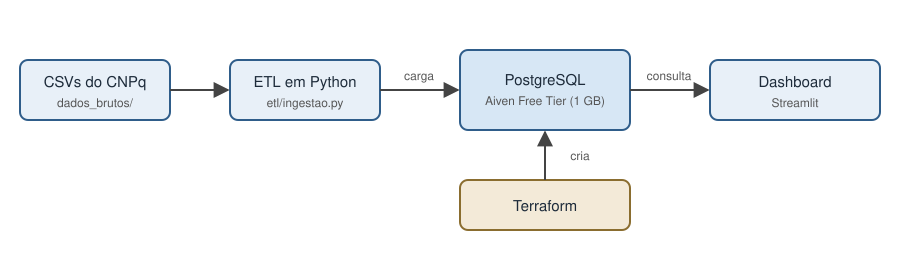
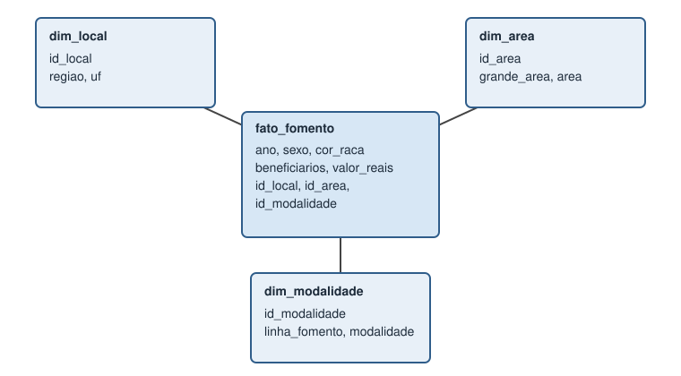

# Auditoria de Viés Étnico-Gênero no Fomento à Pesquisa (CNPq)

O projeto analisa se as bolsas e os auxílios do CNPq chegam de forma desigual conforme **sexo** e **cor/raça** (ODS 5 e ODS 18).

**Dashboard:** _(cole aqui o link do Streamlit Cloud)_

## 1. Arquitetura



| Pasta | Conteúdo |
|---|---|
| `dados_brutos/` | CSVs do Painel de Fomento do CNPq (2020 a 2026) |
| `terraform/` | Cria o banco PostgreSQL na Aiven |
| `etl/` | Lê, limpa e carrega os dados no banco |
| `dashboard/` | Painel em Streamlit |

## 2. Os 5 V's

| V | No projeto |
|---|---|
| **Volume** | 378 MB e 572 mil registros. Guardamos só as colunas úteis, e o banco fica com cerca de 60 MB (o limite é 1 GB). |
| **Variedade** | CSV tabular (dados estruturados). |
| **Velocidade** | Carga em lote, um arquivo (ano) por vez. O GitHub Actions roda o ETL uma vez por mês. |
| **Veracidade** | Removemos duplicatas e a linha "Total" de cada arquivo e convertemos "R$" em número. Conferimos que a soma no banco bate com o total oficial de cada ano. |
| **Valor** | Mostra desigualdades de gênero e raça no fomento público. |

**Tipos de dados:**
- **Estruturado:** os CSVs. É o único tipo usado na análise.
- **Semi-estruturado:** o `.env` e os arquivos do Terraform, usados só na configuração.
- **Não estruturado:** textos livres como "Instituição" e "Programa", que foram descartados.

## 3. LGPD

- A base é pública e não tem nome nem CPF.
- Removemos naturalidade, nacionalidade, instituição e cidade, porque juntas poderiam identificar um pesquisador. O nível mais detalhado que fica é o estado.
- Nenhuma senha fica no código. Elas ficam no `.env` (fora do Git) e nos Secrets do GitHub e do Streamlit.

## 4. Banco de dados

Usamos **PostgreSQL (relacional)** porque os dados são tabelas com colunas fixas e a análise usa somas e agrupamentos. Não há texto livre nem JSON que justifique um banco não relacional.

O modelo é **estrela**: uma tabela fato com os números e três dimensões com os textos repetidos, para economizar espaço.



A view `vw_fomento` junta as quatro tabelas, e é ela que o dashboard lê.

## 5. Dicionário de dados (`vw_fomento`)

| Coluna | Tipo | Descrição |
|---|---|---|
| `ano` | inteiro | Ano do pagamento (2026 está incompleto) |
| `regiao` / `uf` | texto | Região e estado |
| `grande_area` / `area` | texto | Área do conhecimento |
| `linha_fomento` / `modalidade` | texto | Tipo de apoio (ex.: Iniciação Científica, Doutorado) |
| `sexo` | texto | Feminino, Masculino, Não informado |
| `cor_raca` | texto | Branca, Parda, Preta, Amarela, Indígena, Não declarada |
| `beneficiarios` | decimal | Número de beneficiários |
| `valor_reais` | decimal | Valor pago em R$ |

## 6. Regras de negócio

| Regra | Cálculo |
|---|---|
| Pessoa negra | Preta + Parda (critério do IBGE) |
| Valor médio por beneficiário | Valor total ÷ beneficiários |
| Mediana | Valor do meio das concessões (não é distorcida por bolsas muito altas) |
| Participação de mulheres negras | Mulheres negras ÷ total de beneficiários |
| Gap | Quanto o valor médio de mulheres negras fica abaixo ou acima do valor médio de homens brancos, em % |

**No dashboard:**
- 5 KPIs;
- filtros de ano, região, sexo, raça e área;
- troca entre média e mediana;
- drill-down de região para estado e de área para subárea.

A base não traz idade, então não há filtro de faixa etária.

## 7. Como reproduzir

Você precisa de Python, [Terraform](https://developer.hashicorp.com/terraform/install) e uma conta gratuita na [Aiven](https://console.aiven.io).

```bash
git clone https://github.com/guilhermemirandaa/projeto-bigdata-vies-cnpq.git
cd projeto-bigdata-vies-cnpq
pip install -r requirements.txt

cp .env.example .env          # preencha o token e o projeto da Aiven
set -a; source .env; set +a

terraform -chdir=terraform init
terraform -chdir=terraform apply
terraform -chdir=terraform output -raw database_url   # cole em DATABASE_URL no .env

python etl/ingestao.py
streamlit run dashboard/app.py
```

**Publicar:** no [Streamlit Cloud](https://share.streamlit.io), aponte para `dashboard/app.py` e adicione `DATABASE_URL` em *Secrets*. No GitHub, crie o mesmo secret em *Settings → Secrets → Actions*.
