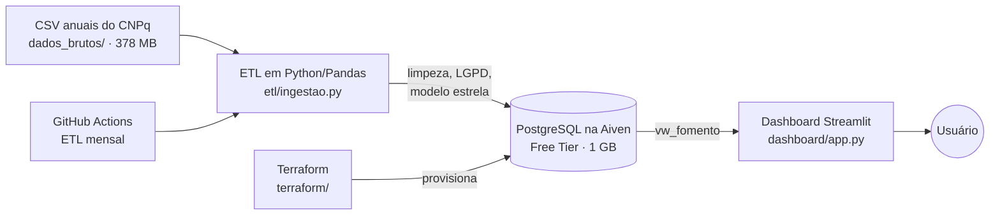
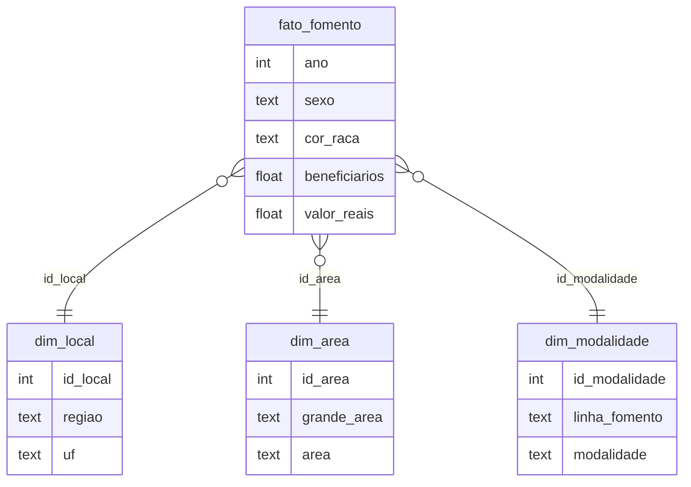

# Auditoria de Viés Étnico-Gênero no Fomento à Pesquisa (CNPq)

Projeto prático de Big Data e Analytics. O projeto investiga se as bolsas e os auxílios do CNPq chegam de forma desigual a pesquisadores conforme **sexo** e **cor/raça** (ODS 5: Igualdade de Gênero; ODS 18: Igualdade Étnico-Racial).

**Pergunta central:** uma mulher negra recebe, em média, o mesmo fomento que um homem branco?

**Dashboard publicado:** _(cole aqui o link do Streamlit Cloud)_

---

## 1. Arquitetura



| Pasta | O que tem |
|---|---|
| `dados_brutos/` | Extrações do Painel de Fomento do CNPq, de 2020 a 2026 (um CSV por ano) |
| `terraform/` | `main.tf`, `variables.tf` e `outputs.tf`, que criam o PostgreSQL na Aiven |
| `etl/` | `ingestao.py` (extração, limpeza e carga) |
| `dashboard/` | `app.py` (painel em Streamlit) |
| `.github/workflows/etl.yml` | Roda o ETL em lote, usando o GitHub Secret `DATABASE_URL` |

## 2. Os 5 V's aplicados ao dataset

| V | No nosso projeto |
|---|---|
| **Volume** | São 7 arquivos, 378 MB e cerca de 572 mil registros. O ETL guarda só 11 das 28 colunas e troca textos repetidos por ids (modelo estrela), e o banco fica com cerca de 22 MB, bem abaixo do limite de 1 GB da Aiven. |
| **Variedade** | Dados **estruturados**: CSV tabular, codificado em UTF-16 e separado por TAB. O texto livre de "Instituição" e "Programa" foi descartado. |
| **Velocidade** | O CNPq atualiza o painel periodicamente. Simulamos essa chegada em **lote** com o GitHub Actions, que roda o ETL todo dia 1º do mês ou sob demanda. O ETL também processa **um arquivo (ano) por vez**. |
| **Veracidade** | Removemos a linha "Total" que vem no fim de cada arquivo, removemos duplicatas, convertemos textos como `"R$ 1.600,00"` e `"-R$ 472,93"` (estorno) em número e tratamos nulos. Para validar, a soma carregada no banco **bate centavo por centavo** com o total oficial de cada ano. |
| **Valor** | O painel mede quanto do fomento público chega a cada grupo de sexo × raça e expõe gaps que orientam políticas de equidade, como cotas em editais e bolsas afirmativas. |

### Classificação dos tipos de dados

| Tipo | O que é no projeto | O que fizemos |
|---|---|---|
| **Estruturado** | Os CSVs do CNPq: linhas e colunas com esquema fixo (ano, sexo, raça, valor...) | É a base de toda a análise. Vai para o PostgreSQL. |
| **Semi-estruturado** | Saídas da Aiven/Terraform (estado e outputs em JSON) e o `.env` (chave=valor) | Usados só para configurar a infraestrutura, não para análise. |
| **Não estruturado** | Textos livres dentro do CSV, como o nome do "Programa" e da "Instituição" | Descartados: não entram nos indicadores, e a instituição poderia ajudar a identificar pessoas (LGPD). |

## 3. LGPD

- A base é **pública** (Lei de Acesso à Informação) e **não traz nome, CPF nem Lattes**.
- Mesmo assim, raça e sexo combinados com instituição, cidade e país de nascimento podem identificar uma pessoa. Um exemplo é uma pesquisadora indígena nascida no Vietnã que trabalha numa universidade pequena. Por isso o ETL **descarta** `Naturalidade`, `Nacionalidade`, `Instituição`, `Cidade` e `Cod Município IBGE`. O nível geográfico mais fino guardado é a **UF**.
- Raça e sexo são dados sensíveis (art. 5º, II). Usamos esses campos só de forma **agregada** e com finalidade de pesquisa e interesse público (art. 7º, IV, e art. 11, II, "c").
- Nenhuma senha fica no código: usamos `.env` local (ignorado pelo Git), GitHub Secrets e Secrets do Streamlit Cloud.

## 4. Modelo de dados (estrela) e por que um banco relacional



- **Relacional (PostgreSQL)** porque o dado é tabular, tem esquema fixo e a análise é feita com somas, médias e agrupamentos, que é o ponto forte do SQL. Não temos texto livre nem JSON que justifiquem um banco NoSQL como o OpenSearch.
- **Estrela** porque a tabela fato guarda os números (valor e beneficiários) e as dimensões guardam os textos repetidos (região, área, modalidade) uma vez só. Isso economiza espaço, importante por causa do limite de 1 GB, e facilita filtrar.
- `sexo` e `cor_raca` ficaram direto na fato porque têm poucas categorias. Uma tabela só para eles não economizaria nada.
- A view **`vw_fomento`** junta a estrela numa tabela só, e é ela que o dashboard lê.

## 5. Dicionário de dados (`vw_fomento`)

| Coluna | Tipo | Origem no CSV | Descrição |
|---|---|---|---|
| `ano` | int | Ano de Exercício | Ano do pagamento (2026 é **parcial**, extraído em 09/09/2026) |
| `regiao` | texto | Região | Norte, Nordeste, Centro-Oeste, Sudeste, Sul, Exterior |
| `uf` | texto | Unidade Federação | Estado do beneficiário |
| `grande_area` | texto | Grande Area | Grande área do conhecimento (CNPq) |
| `area` | texto | Area | Área do conhecimento |
| `linha_fomento` | texto | Linha de Fomento | Ex.: bolsas de formação, apoio a projetos |
| `modalidade` | texto | Modalidade | Ex.: Iniciação Científica, Doutorado, Produtividade |
| `sexo` | texto | Sexo | Feminino, Masculino, Não informado |
| `cor_raca` | texto | Cor ou Raça | Branca, Parda, Preta, Amarela, Indígena, Não declarada |
| `beneficiarios` | decimal | Benef. Modal / Ano | Beneficiários do registro no ano (pode ser fracionado, ex.: 0,5) |
| `valor_reais` | decimal | Valor em Real (R$) | Valor pago em reais (estornos são negativos) |

## 6. Regras de negócio

| # | Regra | Como é calculada |
|---|---|---|
| R1 | **População negra** | Pretos + pardos (critério do IBGE) |
| R2 | **Total investido** | `soma(valor_reais)` |
| R3 | **Beneficiários** | `soma(beneficiarios)` |
| R4 | **Valor médio por beneficiário** | `soma(valor_reais) / soma(beneficiarios)` |
| R5 | **Mediana por concessão** | Mediana de `valor_reais` por registro. Diferente da média, não é distorcida por poucas bolsas muito altas. |
| R6 | **Participação de mulheres negras** | Beneficiárias mulheres negras ÷ total de beneficiários |
| R7 | **Gap interseccional** | (valor médio por beneficiário de mulheres negras ÷ o de homens brancos − 1) × 100. Um valor negativo significa que mulheres negras recebem menos. |
| R8 | **Não declarada** | Quem marcou "Não desejo declarar" **continua** na base com o rótulo "Não declarada", porque a taxa de não declaração também é informação |

Regras de limpeza do ETL: remoção da linha "Total", remoção de duplicatas (comparando a linha inteira, antes de cortar colunas), conversão de "R$" para número, descarte de registros sem valor e troca de textos vazios por "Não informado".

## 7. Dashboard

- **KPIs:** total investido, beneficiários, valor médio por beneficiário, participação de mulheres negras e gap mulher negra × homem branco.
- **Filtros cruzados:** ano, região, sexo, cor/raça e grande área. Todos os gráficos e KPIs obedecem aos filtros.
- **Seletor de métrica:** total, beneficiários, média ou mediana.
- **Seletor de eixo:** ano, região, grande área ou linha de fomento.
- **Matriz interseccional** sexo × raça.
- **Drill-down:** você escolhe um item e vê o detalhe dele (região → UF, grande área → área, linha → modalidade, ano → região).

> A base não traz idade, por isso não existe filtro de faixa etária.

## 8. Como reproduzir (Deployment Guide)

**Pré-requisitos:** Python 3.10+, [Terraform](https://developer.hashicorp.com/terraform/install) e uma conta gratuita na [Aiven](https://console.aiven.io) com um projeto criado.

```bash
# 1. Clonar e instalar
git clone https://github.com/guilherme12121/projeto-bigdata-vies-cnpq.git
cd projeto-bigdata-vies-cnpq
python -m venv .venv && source .venv/bin/activate
pip install -r requirements.txt

# 2. Credenciais: copie o modelo e preencha o token e o projeto da Aiven
cp .env.example .env
set -a; source .env; set +a

# 3. Criar o banco na Aiven
terraform -chdir=terraform init
terraform -chdir=terraform apply
terraform -chdir=terraform output -raw database_url   # copie para DATABASE_URL no .env

# 4. Rodar o ETL (lê dados_brutos/, trata e carrega no banco)
python etl/ingestao.py

# 5. Abrir o dashboard
streamlit run dashboard/app.py
```

> Se o `terraform apply` reclamar do plano, veja o nome do plano gratuito com `avn service plans --service-type pg` (ou no Console da Aiven) e rode `terraform apply -var plan=<nome>`.

**Publicar o dashboard:** em [share.streamlit.io](https://share.streamlit.io), crie um app apontando para `dashboard/app.py` e, em *Settings → Secrets*, adicione `DATABASE_URL = "postgres://..."`.

**GitHub Actions:** em *Settings → Secrets and variables → Actions*, crie o secret `DATABASE_URL`. Depois rode o workflow "ETL CNPq" na aba *Actions*.

